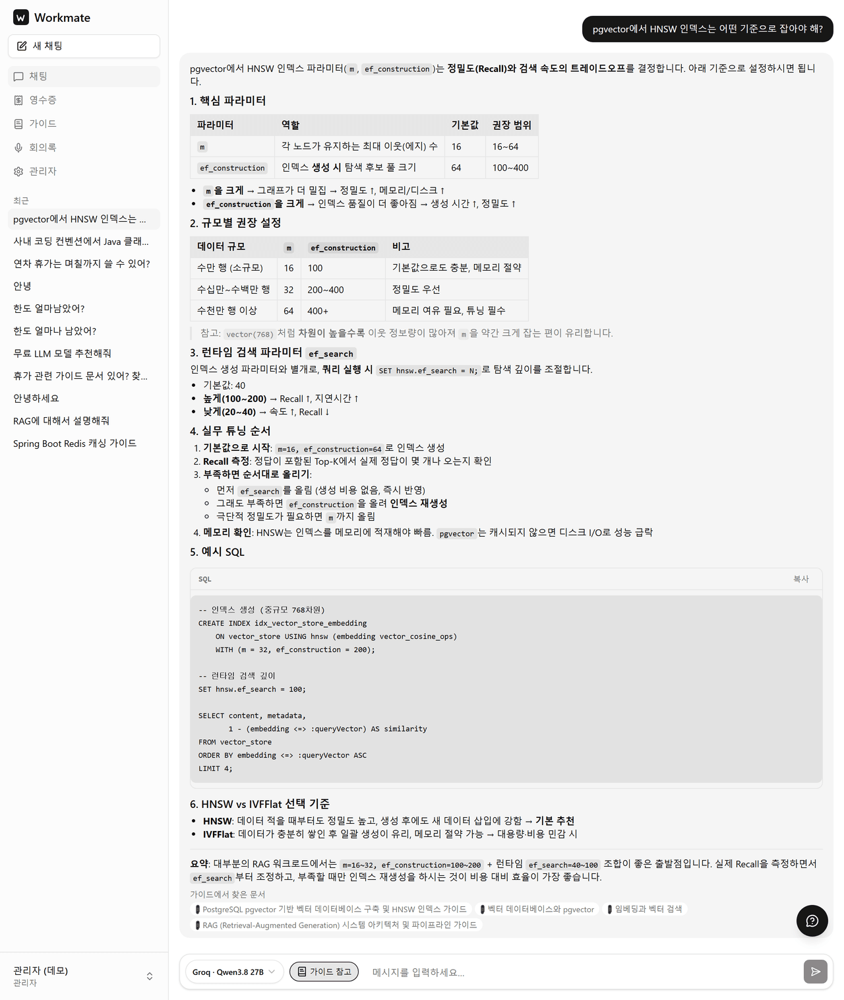
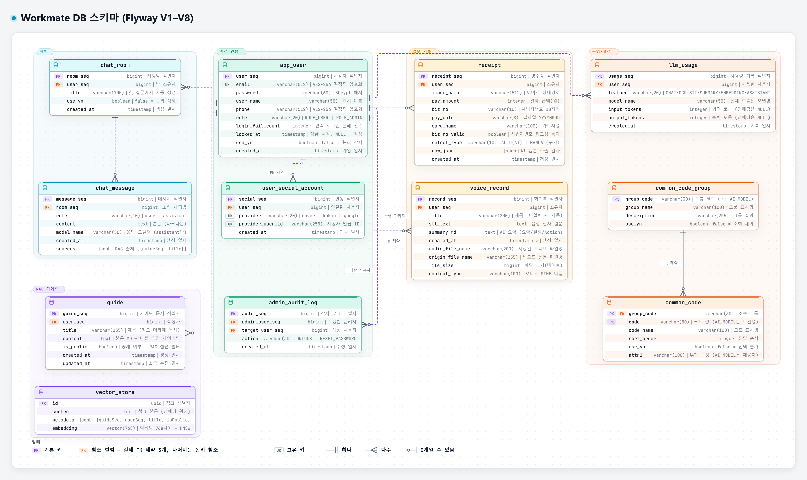
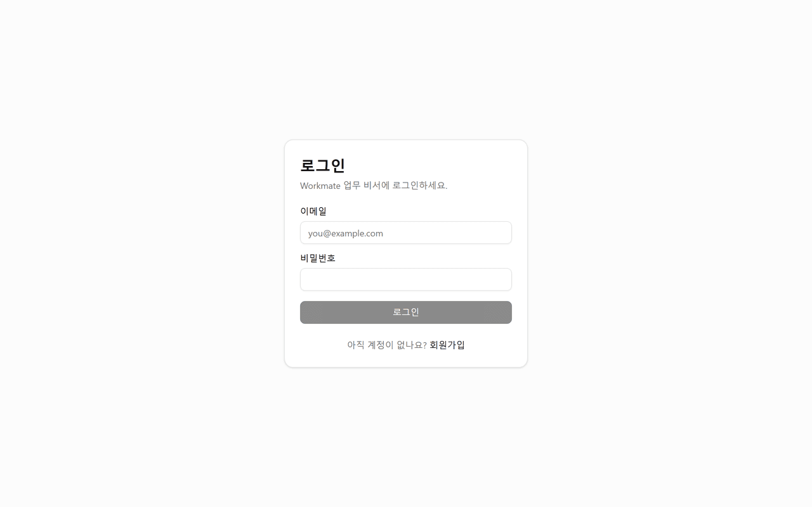
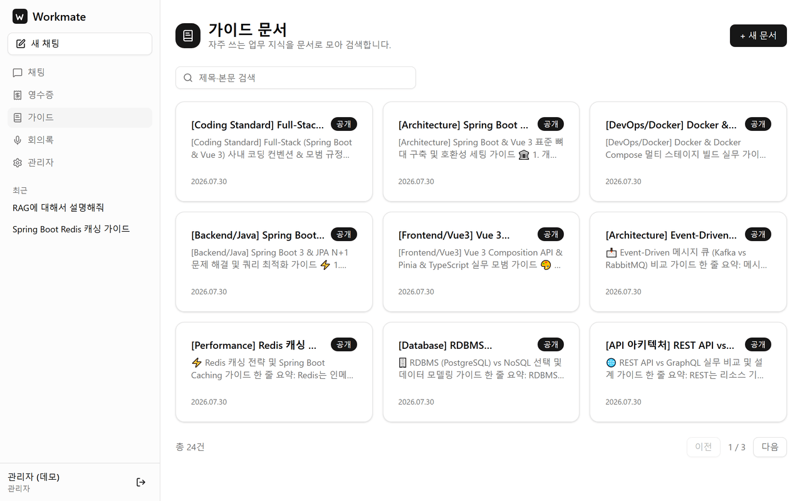
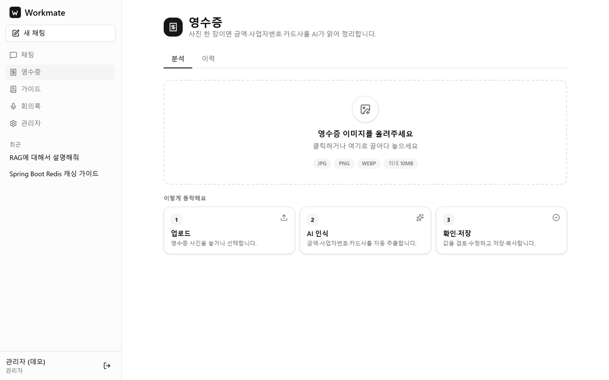
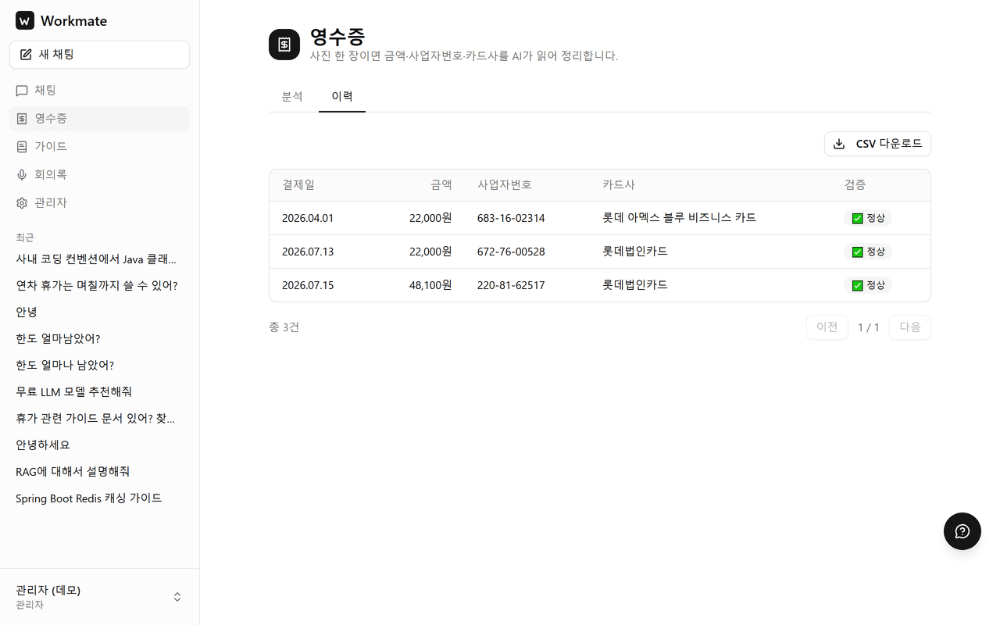
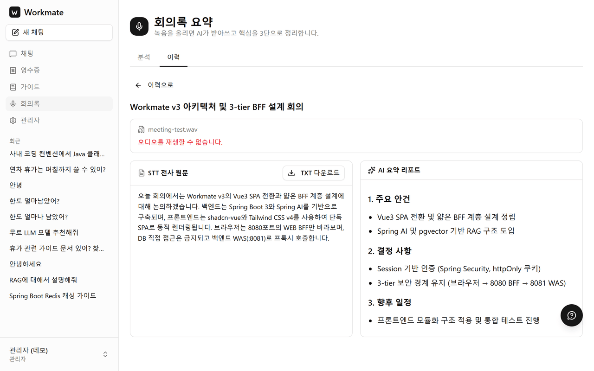
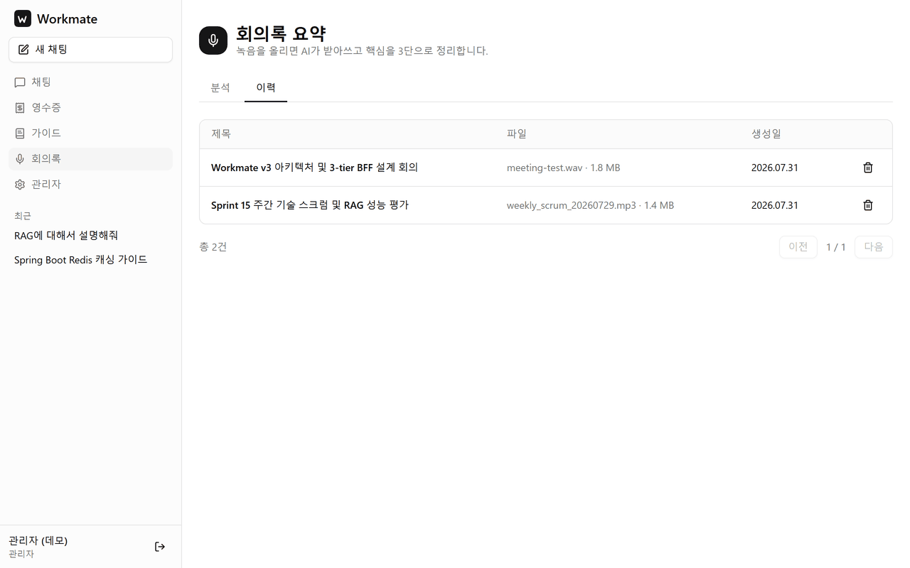
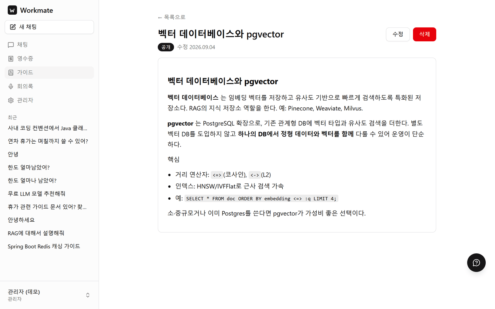
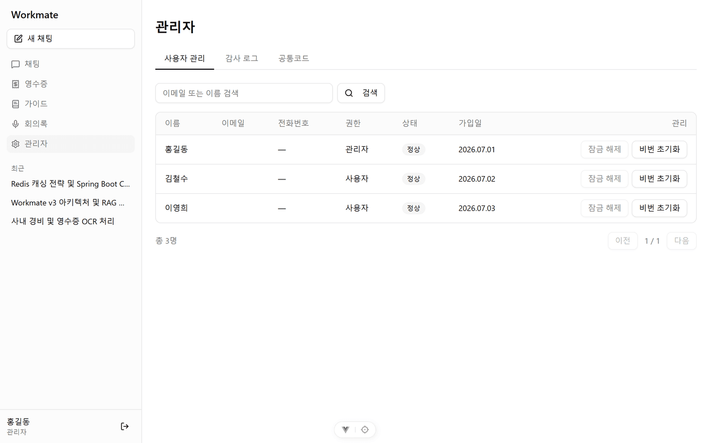

# Workmate

[](https://github.com/taekyung96/workmate/actions/workflows/ci.yml)

Spring AI 로 만든 사내 업무 비서 웹앱이다. 채팅 답변을 토큰 단위로 스트리밍하고 사내 가이드를 먼저 검색(RAG)해 근거가 있으면 출처와 함께 답한다. 영수증 인식과 회의록 요약도 같은 화면에서 쓴다.

기능을 만들고 끝내지 않았다. 검색이 제대로 되는지는 골든셋으로 점수를 매겨 확인했고 서버가 얼마나 버티는지는 k6 로 부하를 걸어 봤고 인스턴스를 늘려도 로그인이 유지되는지는 두 대를 띄워 확인했다. 아래 "핵심 판단"에 그 과정에서 내린 결정 세 가지와, 결정의 근거이자 검증이 된 숫자를 적었다.

<!-- demo-url:start -->

> 🔗 **라이브 데모** — 준비 중이다. 고정 도메인을 붙이는 대로 여기에 주소를 적는다.
>
> 그전까지는 [아래 실행 방법](#실행)으로 직접 띄워 볼 수 있다. `docker compose up -d` 한 번이면
> 스키마·가이드 24건·pgvector 임베딩까지 시드된 상태로 뜨고 아래 화면들이 그대로 나온다.

<!-- demo-url:end -->



## 핵심 판단

### 1. 답이 없는 질문까지 재서 threshold 를 정했다

골든셋 33문항(질문과 정답 문서 쌍)으로 `topK`·`threshold` 를 훑는 평가 하네스를 만들었다. 정답 문서가 상위 몇 개 안에 드는지(Hit@K)와 몇 등으로 나오는지(MRR)를 잰다.

그런데 이 지표는 정답이 있는 질문만 본다. 실제로 "연차 휴가 며칠?"처럼 가이드에 없는 질문에 무관한 개발 문서가 딸려 나왔다. 그래서 **답이 없는 질문 8문항**을 따로 두고 오탐률을 같이 쟀다.

|          threshold |      Hit@K |       MRR |    오탐률 |
| -----------------: | ---------: | --------: | --------: |
|     0.40 (이전 값) |     100.0% |     0.970 |    100.0% |
| **0.50 (현재 값)** | **100.0%** | **0.970** | **62.5%** |
|               0.60 |      97.0% |     0.955 |      0.0% |

0.5 는 0.4 보다 잃는 게 없다. 0.6 은 오탐이 사라지지만 답이 있는 질문을 놓치기 시작한다. 놓친 답은 틀린 답이지만 헛붙은 문서 목록은 표시의 문제라고 보고 0.5 를 골랐고 화면 표기도 "출처"에서 "가이드에서 찾은 문서"로 바꿨다. → [평가 리포트](docs/features/rag-eval/REPORT.md)

아직 남은 한계도 있다. 권한 필터(본인 문서 + 공개 문서)가 `topK` 뒤에 붙어 있어서 남의 비공개 문서가 상위를 차지하면 그만큼 근거가 줄어든다. 필터를 벡터 검색 단계(`filterExpression`)로 내리는 것이 다음 개선 방향이다.

### 2. 제목만 고쳐도 임베딩을 다시 만들던 것을 없앴다

가이드를 수정하면 본문이 그대로여도 임베딩을 전부 지우고 다시 만들었다. 제목·공개 여부는 청크 메타데이터일 뿐 벡터에는 들어가지 않는데도 그랬다. 무료 티어 한도가 낮아 이 낭비가 곧 429 오류로 이어졌다.

본문이 바뀌었는지 먼저 보고 그대로면 `vector_store` 의 메타데이터만 jsonb 병합으로 갱신하게 바꿨다. 제목·공개 여부만 고칠 때 임베딩 API 호출이 **문서당 평균 1.12회 → 0회**가 됐고 바꾼 뒤 다시 돌린 RAG 평가 수치는 그대로였다. → [원인 분석](docs/architecture/RAG_VECTORSTORE_EMBEDDING_QUOTA_GUIDE.md)

### 3. 인증은 JWT 가 아니라 세션으로 했다

계정 잠금과 중복 로그인 차단은 서버가 로그인을 그 자리에서 끊을 수 있어야 한다. JWT 는 만료 전에 회수하기 어려워 세션(httpOnly 쿠키)을 골랐고 대가로 CSRF 방어를 켰다.

세션은 서버에 상태가 있으니 WEB 을 두 대로 늘리면 로그인이 풀린다. 세션·중복 로그인 판정·레이트리밋을 Redis 로 옮긴 뒤, 두 인스턴스에 부하를 나눠 건 검사 32,718건이 모두 통과했다. → [ADR-0001](docs/project/adr/0001-spa-bff-session-auth.md) · [Redis 전후 검증](docs/features/redis/REPORT.md)

## 구조

```
브라우저 (Vue3 SPA)
   │  HTTP(세션) + SSE
workmate-web (:8080)   얇은 BFF — SPA 서빙 · 세션 인증 · /api 프록시 · SSE 중계
   │  (내부망)
workmate-was (:8081)   비즈니스 로직 · JPA/MyBatis · Spring AI
   │
PostgreSQL 17 + pgvector · Redis
```

브라우저는 8080 만 본다. WEB 은 DB 에 접근하지 않고 WAS 를 중계만 하며 권한 판정은 WAS 가 한다.

- **workmate-vue** — Vue 3.5 · Vite 8 · TypeScript · Pinia 3 · Tailwind v4 + shadcn-vue
- **workmate-web** — Java 17 · Spring Boot 3.5 · Spring Security(세션) · Spring Session(Redis)
- **workmate-was** — Java 17 · Spring Boot 3.5 · Spring AI 1.1 · JPA + MyBatis · Flyway
- **AI** — 채팅 Groq Qwen3.8 27B · Gemini(화면에서 전환), 영수증·음성 Gemini 멀티모달, 임베딩 gemini-embedding-001

자세한 구성은 [아키텍처](docs/development/01_ARCHITECTURE.md), 고르지 않은 선택지와 그 이유는 [ADR](docs/project/adr/)에 있다.

### DB 스키마

Flyway 마이그레이션(V1–V8) 기준 테이블 12개. 타입 칸에는 각 컬럼의 `COMMENT ON` 을 줄여서 같이 적었다.



거의 모든 테이블이 `user_seq` 로 `app_user` 를 가리키지만 DB 가 실제로 FK 제약을 거는 건 3개(`user_social_account`·`voice_record` → `app_user`, `common_code` → `common_code_group`)뿐이다. 나머지는 컬럼 코멘트에 대상을 적어 둔 논리 참조이고 정합성은 WAS 서비스 코드가 지킨다.

## 화면

|                       로그인                        |                  사내 가이드 RAG                   |
| :-------------------------------------------------: | :------------------------------------------------: |
|                  |                 |
|                     영수증 분석                     |                  영수증 인식 이력                  |
|  |  |
|                   회의록 AI 요약                    |                    회의록 이력                     |
|      |    |
|                  사내 가이드 상세                   |                관리자 · 사용자 관리                |
|      |           |

## 실행

```bash
docker compose up -d db                 # pgvector PostgreSQL 17
./gradlew :workmate-was:bootRun         # 8081, .env 에 Gemini·Groq·AES 키 필요
./gradlew :workmate-web:bootRun         # 8080, Vue 빌드까지 자동
```

WAS 를 처음 띄우면 Flyway 가 스키마와 가이드 24건(임베딩 포함)을 넣는다. 데모 계정은 배포마다 다른 AES 키로 암호화해야 해서 마이그레이션에 넣지 않았고 `./scripts/bootstrap-demo-data.sh` 를 한 번 돌리면 `demo.admin@example.com` / `Workmate!2026` 으로 들어갈 수 있다. 배포는 [배포 가이드](docs/development/11_DEPLOYMENT_GUIDE.md) 참고.

## 검증

| 대상              | 테스트 | 실행                                                  |
| ----------------- | -----: | ----------------------------------------------------- |
| workmate-was      |    160 | `./gradlew :workmate-was:test` (실제 PostgreSQL 필요) |
| workmate-web      |     10 | `./gradlew :workmate-web:test` (Redis 필요)           |
| workmate-vue 유닛 |     74 | `cd workmate-vue && npm run test:unit`                |
| E2E (Playwright)  |     61 | `cd workmate-vue && npm run test:e2e`                 |

모두 통과한 상태이고 push·PR 마다 [CI](.github/workflows/ci.yml)가 빈 PostgreSQL 컨테이너에서 같은 테스트를 돈다. E2E 는 데스크탑·노트북·모바일 세 폭에서 레이아웃을 보며 API 는 브라우저에서 가로채 백엔드 없이 돈다.

부하 테스트(k6)에서는 동시 200명에서 약 500 req/s 로 포화했고 한계 요인은 CPU 였다. 측정 조건과 한계는 [부하 테스트 리포트](docs/features/loadtest/REPORT.md)에, 나머지 측정 기록은 [문서 색인](docs/README.md)에 있다.

## 라이선스

[MIT](LICENSE)
